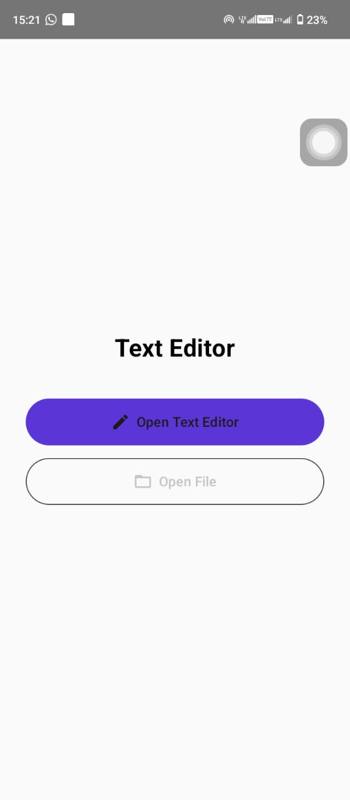
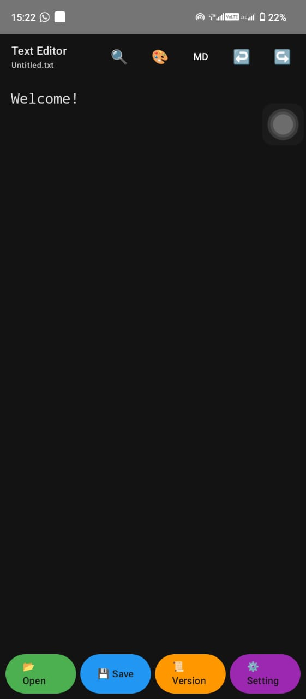
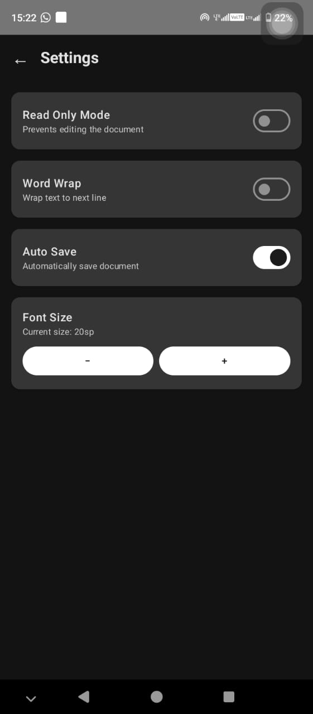

 

# 📝 Text Editor

**A simple Android application for creating, opening and editing text documents.**

[**Download APK**](https://github.com/Hasali12345/TextEditor/releases/tag/v1.0) · [**View Source Code**](https://github.com/Hasali12345/TextEditor)

---

## 📖 About

Text Editor is an Android application developed as a mini project for **IS2205 – Mobile Application Design and Development**. It provides a straightforward interface for writing and editing text, opening existing files, and saving documents. The app also includes additional editing controls and settings to make working with text more convenient.

## ✨ Features

- **Create and edit text** – Write and modify text in the editor.
- **Open files** – Open an existing text document.
- **Save documents** – Save your work.
- **Search** – Find text within the document.
- **Markdown mode** – Switch to Markdown mode.
- **Undo and redo** – Navigate editing changes.
- **Read-only mode** – Prevent accidental document edits.
- **Word wrap** – Wrap long lines onto the next line.
- **Auto save** – Automatically save document changes.
- **Font size controls** – Adjust the editor text size.

## 📱 Screenshots

| Welcome Screen | Text Editor | Settings |
|:---:|:---:|:---:|
|  |  |  |

## 📥 Download and Install

1. Visit the [**Text Editor v1.0 Releases**](https://github.com/Hasali12345/TextEditor/releases/tag/v1.0) page.
2. Download the APK asset.
3. Open the downloaded APK on your Android device.
4. If prompted, allow installation from that source in Android settings.
5. Complete the installation and open **Text Editor**.

> Only install APK files from sources you trust.

## 🧰 Project Information

| Item | Details |
|---|---|
| Project | Text Editor |
| Platform | Android |
| Module | IS2205 – Mobile Application Design and Development |
| Project Type | Mini Project |
| Release | v1.0 |

You can compare this value with the checksum of your downloaded APK to verify that the files match.

## 📂 Repository

[GitHub Repo](https://github.com/Hasali12345/TextEditor)

---

**Developed for IS2205 – Mobile Application Design and Development**

